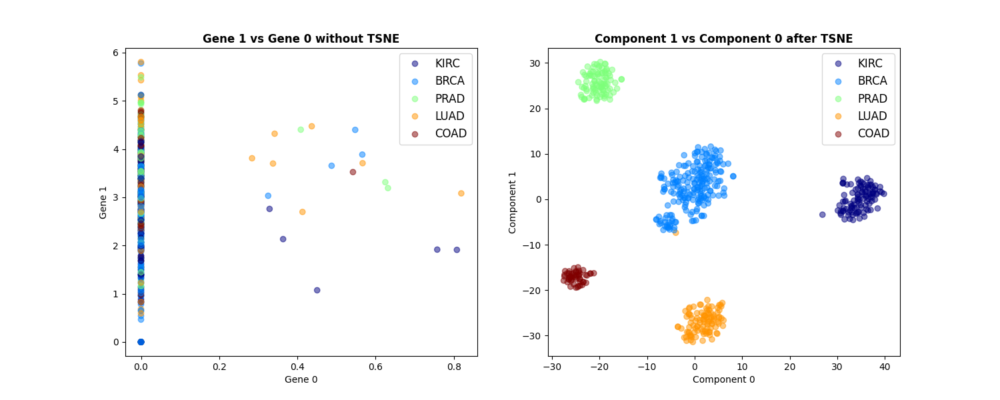
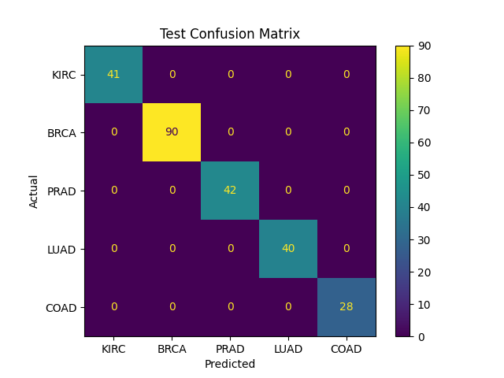

# Interpretable Pan-Cancer Classification via Sparse Elastic-Net Biomarker Discovery

[](https://www.python.org/)
[](LICENSE)
[](https://scikit-learn.org/)
[]()
[]()

An end-to-end machine learning pipeline that resolves the **curse of dimensionality** ($n \gg m$) in transcriptomic pan-cancer analysis. By mapping anonymized UCI RNA-Seq features back to official TCGA gene symbols and applying a sparse Elastic Net feature selection strategy, this project compresses **20,531 gene features down to 39 biologically verified biomarkers** (a **99.82% reduction**) while achieving **100% classification accuracy** on an independent test set across 5 primary cancer types.

---

## Visual Overview

| Latent Space Projection (t-SNE) | Final Evaluation (Test Set Confusion Matrix) |
| :---: | :---: |
|  |  |
| *Clear separation among the 5 cancer classes prior to linear modeling.* | *Perfect generalization ($N=241$) using only the 39 extracted genes.* |

---

## Table of Contents
- [Clinical & Dataset Overview](#clinical--dataset-overview)
- [Methodology & Architecture](#methodology--architecture)
  - [1. Feature Reconstruction](#1-feature-reconstruction)
  - [2. Exploratory Dimensionality Reduction](#2-exploratory-dimensionality-reduction)
  - [3. Sparse Feature Selection (Elastic Net)](#3-sparse-feature-selection-elastic-net)
- [Benchmark Results](#benchmark-results)
- [Scientific & Clinical Validation](#scientific--clinical-validation)
- [Repository Structure](#repository-structure)
- [Getting Started](#getting-started)
  - [Installation](#installation)
  - [Data Acquisition & Placement](#data-acquisition--placement)
  - [Running the Pipeline via CLI](#running-the-pipeline-via-cli)
  - [Notebook Workflow](#notebook-workflow)
- [License](#license)

---

## Clinical & Dataset Overview

This project analyzes the [UCI Gene Expression Cancer RNA-Seq Dataset](https://archive.ics.uci.edu/dataset/401/gene+expression+cancer+rna+seq), sampled from [The Cancer Genome Atlas (TCGA)](https://www.cancer.gov/ccg/research/genome-sequencing/tcga) Pan-Cancer project:

* **Samples:** $m = 801$ patients (Train: $560$, Test: $241$ via a stratified 70/30 split).
* **Initial Dimensionality:** $n = 20,531$ genes (Illumina HiSeq RNA-Seq V2).
* **Target Classes (5 Primary Tumor Types):**
  * `BRCA`: Breast Invasive Carcinoma
  * `KIRC`: Kidney Renal Clear Cell Carcinoma
  * `LUAD`: Lung Adenocarcinoma
  * `PRAD`: Prostate Adenocarcinoma
  * `COAD`: Colon Adenocarcinoma

---

## Methodology & Architecture

```
Raw TCGA / UCI RNA-Seq (20,531 features)
       │
       ▼
Feature Mapping (gene_0...gene_n ➔ Official Gene Symbols)
       │
       ▼
Elastic Net Logistic Regression (SAGA solver, L1/L2 Grid Search)
       │
       ▼
Weight Matrix Extraction & Dynamic Thresholding:
       Threshold = (|W|_max - |W|_min) / 2
       │
       ▼
39 Discovered Gene Biomarkers (99.82% feature reduction)
       │
       ▼
StandardScaler + Logistic Regression Pipeline ➔ 100% Test Accuracy
```

### 1. Feature Reconstruction
The raw UCI RNA-Seq dataset labels genes anonymously (`gene_0`, `gene_1`, etc.), stripping biological interpretability. We mapped each index to official TCGA gene symbols (`SYMBOL|ENTREZ_ID`) extracted directly from the original TCGA Pan-Cancer expression matrix (`unc.edu_PANCAN_IlluminaHiSeq_RNASeqV2.geneExp.tsv` via Synapse ID `syn4301332`).

### 2. Exploratory Dimensionality Reduction
Using 2D t-SNE and PCA, global transcriptomic profiles separated cleanly into distinct cancer clusters. However, latent projections (PCA/t-SNE components) act as black boxes. To make the model clinically actionable, we prioritized finding the exact subset of individual genes responsible for class separation.

### 3. Sparse Feature Selection (Elastic Net)
To derive a fully interpretable "white-box" model:
1. An **Elastic-Net Logistic Regression** model was optimized over parameter space ($C, \ell_1\text{-ratio}$) using randomized cross-validation:
   $$\min_{w} \left[ -\frac{1}{m}\sum_{i=1}^{m} \log P(y^{(i)} \mid x^{(i)}; w) + \lambda \left( \alpha \|w\|_1 + \frac{1 - \alpha}{2} \|w\|_2^2 \right) \right]$$
2. From the coefficient matrix $W \in \mathbb{R}^{K \times D}$ ($K=5$ classes, $D=20,531$ genes), features with zero coefficients across all classes were eliminated.
3. For each retained gene $j$, we computed its maximum absolute weight across all classes:
   $$S_j = \max_{1 \le k \le K} |W_{k, j}|$$
4. A dynamic range threshold was applied:
   $$\text{Threshold} = \frac{S_{\max} - S_{\min}}{2}$$
   Genes satisfying $S_j > \text{Threshold}$ were preserved.

This condensed the input space from **20,531** down to **39 key predictive genes**.

---

## Benchmark Results

### 1. Feature Space Comparison (Full vs. Reduced)

Linear models were evaluated with 5-fold cross-validation; Random Forest was evaluated using Out-Of-Bag (OOB) accuracy.

| Stage | Features ($n$) | Reduction (%) | Logistic Regression (CV) | SVC (CV) | Random Forest (OOB) |
| :--- | :---: | :---: | :---: | :---: | :---: |
| **Raw Data** | 20,531 | 0.00% | — | — | 99.63% |
| **PCA (95% Var)** | Latent PCs | N/A | 99.82% | 99.11% | 94.81% |
| **Elastic Net Selection** | **39** | **99.82%** | **99.82%** | **99.64%** | **99.28%** |

### 2. Final Test Set Evaluation (Reduced 39 Features, $N=241$)

All models trained exclusively on the **39 selected genes** achieved **zero classification errors** on unseen test data:

| Model | Test Accuracy | Correct Samples | Misclassifications |
| :--- | :---: | :---: | :---: |
| **Logistic Regression (StandardScaler)** | **100.0%** | **241 / 241** | **0** |
| **Support Vector Classifier (SVC)** | **100.0%** | **241 / 241** | **0** |
| **Random Forest Classifier** | **100.0%** | **241 / 241** | **0** |

```
              Test Set Confusion Matrix (39 Biomarkers)
              
                 Pred: KIRC   BRCA   PRAD   LUAD   COAD
      Actual:
      KIRC (n=41)     41      0      0      0      0
      BRCA (n=90)      0     90      0      0      0
      PRAD (n=42)      0      0     42      0      0
      LUAD (n=40)      0      0      0     40      0
      COAD (n=28)      0      0      0      0     28
```

---

## Scientific & Clinical Validation

The 39 genes identified by this purely data-driven approach align directly with standard clinical diagnostic immunohistochemistry (IHC) markers and therapeutic oncogenes:

| Gene Selected | Protein / Alias | Cancer Type | Diagnostic / Therapeutic Significance |
| :--- | :--- | :---: | :--- |
| **`KLK3`** | PSA | **PRAD** | Worldwide gold-standard serum biomarker for prostate cancer detection and surveillance ([PMID: 15302825](https://pubmed.ncbi.nlm.nih.gov/15302825/)). |
| **`KLK2`** | Human Kallikrein 2 | **PRAD** | Activates pro-PSA; specific tissue marker for prostate adenocarcinoma ([PMID: 11266155](https://pubmed.ncbi.nlm.nih.gov/11266155/)). |
| **`TMEFF2`** | Tomoregulin-2 | **PRAD** | Androgen-regulated gene evaluated as a prostate-specific therapeutic target ([PMID: 11751478](https://pubmed.ncbi.nlm.nih.gov/11751478/)). |
| **`NKX2-1`** | TTF-1 | **LUAD** | Pathological gold-standard IHC marker confirming primary lung origin in metastatic lesions ([PMID: 21677561](https://pubmed.ncbi.nlm.nih.gov/21677561/)). |
| **`NAPSA`** | Napsin A | **LUAD** | Primary aspartic protease diagnostic partner to TTF-1 for lung adenocarcinoma typing ([PMID: 21677561](https://pubmed.ncbi.nlm.nih.gov/21677561/)). |
| **`SFTPB/C/D`** | Surfactants B, C, D | **LUAD** | Specific to alveolar Type II epithelial cells; retained in lung lineage adenocarcinomas ([PMID: 17012351](https://pubmed.ncbi.nlm.nih.gov/17012351/)). |
| **`ROS1`** | ROS1 Kinase | **LUAD** | Actionable oncogenic fusion target for FDA-approved TKIs (e.g., Crizotinib) ([NCBI: NBK585049](https://www.ncbi.nlm.nih.gov/books/NBK585049/)). |
| **`GATA3`** | GATA-3 | **BRCA** | Master regulator of luminal breast differentiation; diagnostic IHC marker with >90% sensitivity ([PMID: 25906123](https://pubmed.ncbi.nlm.nih.gov/25906123/)). |
| **`SCGB2A2`** | Mammaglobin A | **BRCA** | Secretoglobin marker used to detect occult cells and lymph node micrometastases ([PMID: 10411107](https://pubmed.ncbi.nlm.nih.gov/10411107/)). |
| **`PRLR`** | Prolactin Receptor | **BRCA** | Central receptor in mammary differentiation and hormone-dependent breast carcinoma ([PMID: 18451167](https://pubmed.ncbi.nlm.nih.gov/18451167/)). |
| **`CDX1`** | Caudal Type Homeobox 1| **COAD** | Lineage-specific transcription factor governing intestinal epithelial differentiation ([PMID: 19196968](https://pubmed.ncbi.nlm.nih.gov/19196968/)). |
| **`HNF1B`** | HNF-1 Beta | **KIRC** | Sensitive and specific regulator for clear cell renal cell carcinoma lineage typing ([PMID: 15643446](https://pubmed.ncbi.nlm.nih.gov/15643446/)). |

*Full literature survey available in [`reports/clinical proof for biomarkers.md`](reports/clinical%20proof%20for%20biomarkers.md).*

---

## Repository Structure

```
gene-expression-cancer-classification/
├── data/
│   ├── features_weights/       # Serialized Elastic Net weight matrix
│   │   └── numpy_features_weights_arr.npy
│   ├── processed/              # Filtered, re-mapped train/test splits (.csv)
│   └── raw/                    # UCI data and TCGA annotation mapping (.csv, .tsv)
├── models/                     # Serialized models and pipelines
│   ├── elastic_net_log_reg
│   ├── elastic_net_sgd_log_reg
│   ├── final_pipeline_model    # Deployed pipeline (StandardScaler + LogReg on 39 genes)
│   ├── logistic_regression_pip_39
│   ├── random_forest
│   ├── random_forest_39
│   ├── random_forest_pca
│   └── SVC_pip_39
├── notebooks/                  # Interactive experimentation
│   ├── 01_eda_and_dim_reduction.ipynb
│   ├── 02_preprocessing_and_feature_selection.ipynb
│   └── 03_model_evaluation.ipynb
├── reports/                    # Figures and clinical validation notes
│   ├── clinical proof for biomarkers.md
│   ├── clinical proof for biomarkers.pdf
│   └── figures/
│       ├── confusion_matrix.png
│       └── tsne_plot.png
├── src/                        # Modular production code
│   ├── __init__.py
│   ├── data_loader.py          # Data ingestion, gene re-mapping, train/test splits
│   ├── preprocessing.py        # Feature matrix thresholding & dataset reduction
│   ├── train.py                # Final pipeline training & serialization
│   └── evaluate.py             # Test evaluation & confusion matrix generator
├── requirements.txt            # Python dependencies
├── LICENSE                     # MIT License
└── README.md
```

---

## Getting Started

### Installation

1. **Clone the repository:**
   ```bash
   git clone https://github.com/Lore12434/gene-expression-cancer-classification.git
   cd gene-expression-cancer-classification
   ```

2. **Create and activate a virtual environment:**
   ```bash
   python -m venv venv
   # On Windows:
   venv\Scripts\activate
   # On macOS/Linux:
   source venv/bin/activate
   ```

3. **Install dependencies:**
   ```bash
   pip install -r requirements.txt
   ```

### Data Acquisition & Placement

1. Download the RNA-Seq Pan-Cancer dataset from the [UCI Machine Learning Repository](https://archive.ics.uci.edu/dataset/401/gene+expression+cancer+rna+seq).
2. Download the TCGA annotation file (`unc.edu_PANCAN_IlluminaHiSeq_RNASeqV2.geneExp.tsv`) from [Synapse (ID: syn4301332)](https://www.synapse.org/#!Synapse:syn4301332).
3. Place all raw files in `data/raw/`:
   ```
   data/raw/
   ├── data.csv
   ├── labels.csv
   └── unc.edu_PANCAN_IlluminaHiSeq_RNASeqV2.geneExp.tsv
   ```

### Running the Pipeline via CLI

Execute the modular source pipeline directly from the root directory:

1. **Preprocess data and split into train/test sets:**
   ```bash
   python -c "from src.data_loader import load_and_save_data; load_and_save_data(test_size=0.3)"
   ```

2. **Train the final pipeline on the 39 extracted biomarkers:**
   ```bash
   python -m src.train
   ```

3. **Evaluate performance on the test set and generate the confusion matrix:**
   ```bash
   python -m src.evaluate
   ```

### Notebook Workflow

You can also run through the notebooks interactively:
1. `notebooks/01_eda_and_dim_reduction.ipynb`: EDA, missing-value validation, and t-SNE latent space visualization.
2. `notebooks/02_preprocessing_and_feature_selection.ipynb`: Model benchmarking, PCA vs. Isomap, Elastic Net optimization, coefficient matrix extraction, and dynamic thresholding.
3. `notebooks/03_model_evaluation.ipynb`: 5-fold cross-validation on the 39-feature subset and test-set verification across Logistic Regression, SVC, and Random Forest.

---

## License

This project is licensed under the MIT License — see the [LICENSE](LICENSE) file for details.
```

---

